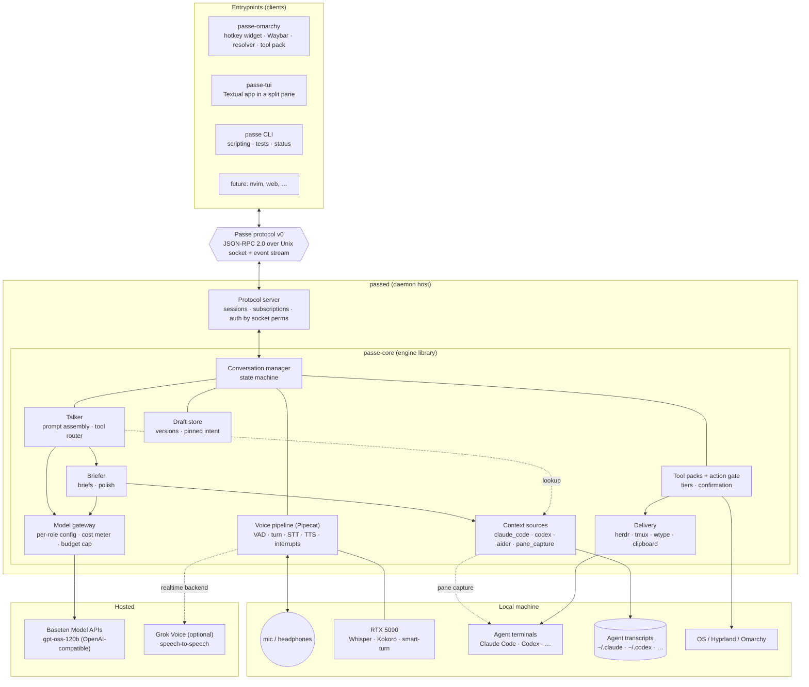
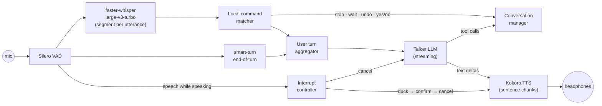
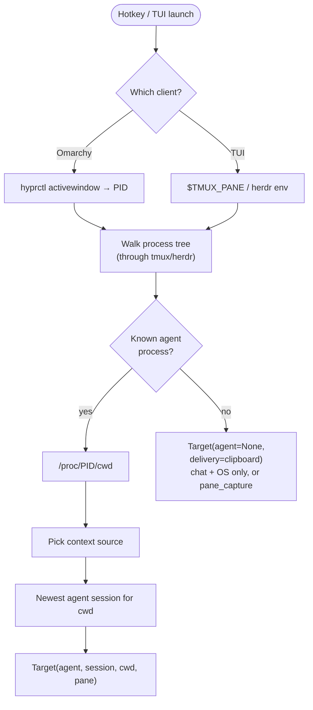
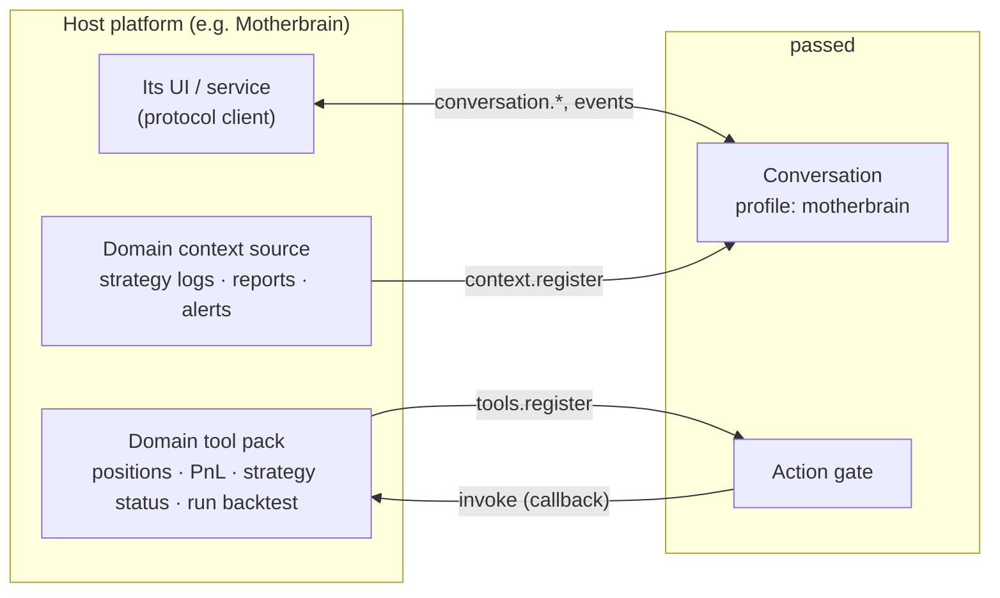
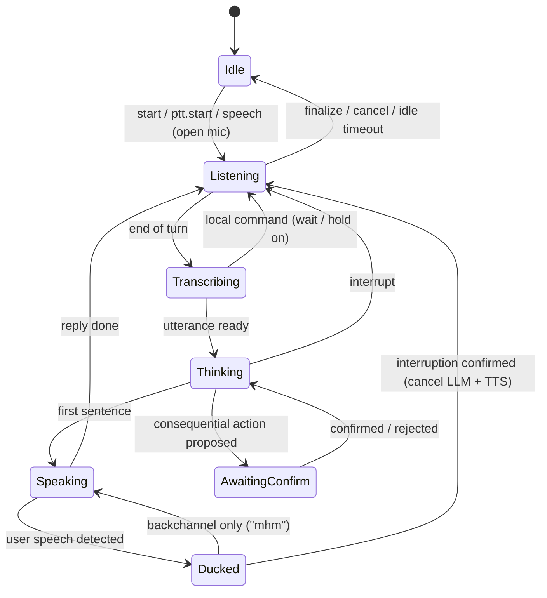
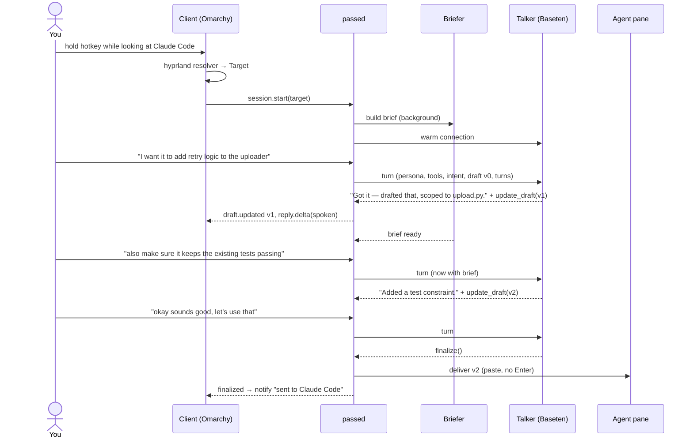
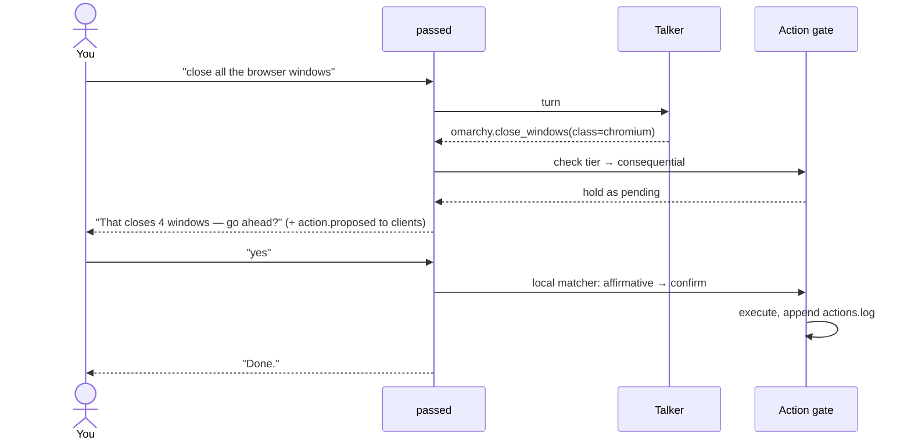
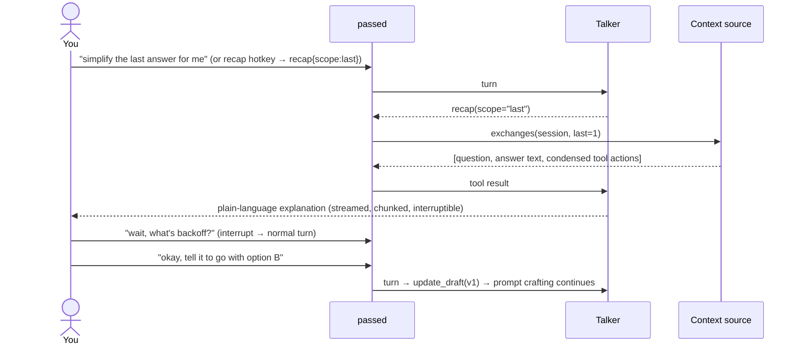

# Architecture

This document describes the planned design of Passe: what the pieces are, how they connect, and the
rules that keep them separate. Decisions behind it are recorded in [`decisions.md`](decisions.md); the wire
format is in [`protocol.md`](protocol.md).

## 1. Goals and non-goals

**Core idea:** a conversational, voice-driven `/btw` for the current agent session. Passe has read-only
access to the session, holds a side conversation about it, and optionally delivers a prompt back into it.

**Goals**

- Hold a fluid spoken conversation that ends with an agreed prompt delivered to a coding agent.
- Ground that conversation in the agent's own session, for any agent (Claude Code, Codex, aider, …).
- Also handle OS actions and plain conversation in the same conversation.
- Multiple entrypoints (Omarchy desktop, terminal, scripts) over one engine.
- Embeddable in other platforms (e.g. Motherbrain), which bring their own tools and context (§5.4).
- Run on one local machine with a small budget: local speech models, one cheap hosted LLM call per turn.

**Non-goals (for now)**

- Remote or multi-user operation. Audio and daemon are on the same machine.
- Replacing the agent. Passe prepares and delivers prompts; it doesn't do the coding work.
- Wake words or always-on listening outside an explicit conversation.

## 2. Glossary

| Term | Meaning |
|---|---|
| **Conversation** | One Passe dialogue, from the first utterance to finalize or cancel. Owned by the daemon. |
| **Agent session** | A session of an external agent (e.g. a Claude Code transcript). Passe reads it, never writes it. |
| **Target** | What a conversation is about and where results go: agent kind, agent session, working directory, delivery route. |
| **Brief** | A compact summary of an agent session (goal, state, decisions, open problems, files). Produced by the briefer. |
| **Draft** | The prompt being worked on. Versioned; every edit makes a new version. |
| **Talker** | The fast LLM that runs every conversational turn. |
| **Briefer** | A slower/stronger LLM role that runs off the hot path (briefs, optional polish). |
| **Tool pack** | A named set of tools the talker may call (prompt, omarchy, tmux, …), each tool tagged with a safety tier. |
| **Entrypoint / client** | Anything that talks to the daemon over the protocol: CLI, TUI, Omarchy glue. |

## 3. System overview



### The rules

1. **Clients only speak the protocol.** No client imports `passe-core`. A client can be Python, shell or Lua.
2. **The core never imports a client** and never assumes a desktop. It receives a `Target`; it doesn't work one out.
3. **There is always a daemon.** Clients start it on demand. It owns everything shared
   (models, audio devices, cost meter, brief cache); each entrypoint runs its own conversations with its own
   profile (§4.2).
4. **Everything agent-specific is an adapter** (context source, delivery, resolver). Everything
   environment-specific is a tool pack. Nothing else knows about Claude Code or Hyprland.
5. **Third-party frameworks stay inside.** Pipecat and the Baseten SDK are wrapped behind Passe interfaces;
   the protocol never exposes them.

## 4. Components

### 4.1 `passed`: daemon host

Runs as a `systemd --user` service (or is started by a client). Responsibilities:

- Loads the local models (Whisper, Kokoro, smart-turn, Silero) into the GPU once, and unloads them after a
  configurable idle timeout.
- Owns the audio devices.
- Serves the protocol on `$XDG_RUNTIME_DIR/passe/passed.sock`. Access control is the socket's file
  permissions (user-only).
- Hosts **several conversations at once**, one or more per client, each with its own profile. Only one
  can hold the **audio focus** (mic + output) at a time; see §4.2.
- Writes logs, the action log and the cost ledger under `~/.local/state/passe/`.

### 4.2 Conversation manager

The core's coordinator. Holds the conversation state machine (§6), the transcript of the conversation, the
current `Target`, the loaded tool packs, and the draft store. It turns protocol commands into pipeline actions
and pipeline happenings into protocol events.

Key responsibilities:

- **Starting a conversation**: takes a `Target`, picks which tool packs apply, kicks off the briefer, warms
  the model connection.
- **Mode**: `open_mic` (default, fluid) or `ptt` (push-to-talk). Pressing push-to-talk while Passe is speaking counts as an interruption.
- **Ending a conversation**: on finalize, cancel or idle timeout.

**Profiles.** Each entrypoint serves a different need, so a conversation starts from a profile that sets
its tool packs, default mode, speech style and lifetime:

| Profile | Used by | Packs | Character |
|---|---|---|---|
| `desktop` | Omarchy widget | prompt, session, chat, omarchy | Quick: pop up, ask or hand off a prompt, close. Short-lived. |
| `workbench` | passe-tui | prompt, session, chat, tmux/herdr | Deep work next to one agent session. Long-lived, typing + voice. |
| `headless` | CLI, tests | as requested | No audio; `say` only. |

Profiles are defined in config, so new entrypoints can define their own.

**Audio focus.** Conversations share the mic and headphones, so the daemon gives audio to one conversation at
a time. Starting or resuming voice in one conversation (a hotkey, a TUI key) moves the focus there. The others
keep their state and drafts and can still take typed input. Waybar and every client show which conversation
has the focus.

### 4.3 Voice pipeline (Pipecat)



| Stage | Choice | Notes |
|---|---|---|
| Transport | Pipecat local audio transport | Headphones are the primary setup, so no echo cancellation. A `speakers` profile can add PipeWire's WebRTC echo-cancel source later. |
| VAD | Silero | CPU, always running in open-mic mode. |
| End of turn | smart-turn + silence backstop (~1.2 s) | Silence alone either cuts you off mid-thought or feels sluggish. "Hold on" extends the turn. |
| STT | faster-whisper large-v3-turbo | Transcribes each utterance after a pause; about 100 ms on the 5090. Vocabulary hints (file/symbol names from the brief) go in `initial_prompt`. Parakeet (English only, D19) is benchmarked against it in M0. |
| Local command matcher | Regex/keyword over final transcripts | "stop", "wait", "hold on", "undo that", and yes/no while an action is pending. Needs no LLM round trip and must be instant and reliable. |
| TTS | Kokoro (GPU), Piper fallback | Starts at the first complete sentence. Each chunk records the text it carried so the controller knows what was actually spoken. |
| Interrupt controller | Passe component on Pipecat interruption frames | See §7.2. |

**Latency budget** (target, measured in M0):

| Segment | Target |
|---|---|
| Your speech start → Passe audio ducked/stopped (interruption) | < 200 ms |
| End-of-turn detection | 300–500 ms |
| STT of the final segment | ~100 ms |
| Talker time to first token | < 600 ms |
| TTS time to first audio | < 150 ms |
| **You stop talking → first audio** | **~1 s (≤ 1.5 s acceptable)** |

**Voice backends.** The pipeline above is the `cascade` backend. A `realtime` backend (Grok Voice; OpenAI
Realtime / Gemini Live possible) replaces VAD → STT → talker → TTS with a single speech-to-speech
WebSocket session, using the same tools (`update_draft`, `finalize`, …) through function calling. The
conversation manager, draft store, tool gate and protocol are identical for both. The realtime backend is
optional and expensive (see [`feasibility.md`](feasibility.md)); use it with push-to-talk and close the
socket when idle.

### 4.4 Talker

The talker runs every conversational turn on a fast model (default **gpt-oss-120b, reasoning effort
low**, via Baseten).

**Prompt assembly, ordered so the fixed part comes first and stays cacheable:**

```
[system]  Passe persona + rules            ← fixed
[tools]   tool schemas of the loaded packs ← fixed for the conversation
[user]    pinned intent                    ← fixed once stated
          brief (if ready)                 ← fixed once ready
          current draft (version n)        ← changes
          recent turns (last ~10)          ← changes
          latest user utterance            ← changes
```

The tool set is chosen at conversation start and **not changed mid-conversation**, so the cached prefix
survives. Rough size: 3–5k tokens per turn, whatever the length of the agent session.

**Behavioral rules (in the system prompt):**

- Spoken output is one or two sentences. Lead with the change ("Added a constraint about tests").
  **Exception: explaining.** When asked to simplify or recap, talk at length in short sentences, describe
  code instead of reading it, and stop at natural points so the user can steer.
- Never read the draft aloud. Edit it through `update_draft`; the UI shows it.
- Ask before restructuring the draft.
- Point it out when the draft drifts away from the pinned intent.
- Call `finalize` only after clear user approval.
- Use `lookup` when the brief lacks something rather than guessing.

**Tool routing:** there are no modes. The model picks from whatever tools are loaded. "Make it mention
tests" → `update_draft`; "turn the volume down" → `omarchy.set_volume`; "what do you think about X" → just
talks. Keep it to about 10–15 tools loaded at once; small models get worse at choosing as the list grows.

### 4.5 Briefer

A model role that runs **off the hot path** (default gpt-oss-120b with reasoning high; can be raised to
something stronger, e.g. GLM-5.3 with thinking on).

- **Brief:** started the moment a conversation begins. Reads the agent session through its context source and
  produces: goal, current state, recent decisions, open problems, relevant files, and a vocabulary list for
  STT. The talker works without a brief until it lands, then gets it in the next turn.
- **Incremental briefs:** cached per agent session in `~/.cache/passe/briefs/`; a later conversation only
  summarizes what's new since the cached brief.
- **Polish (on demand):** "polish it" sends the current draft plus brief to the briefer model for a final pass.
  The result becomes a new draft version.

### 4.6 Context sources

The adapter interface:

```python
class ContextSource(Protocol):
    kind: str                                   # "claude_code", "codex", …
    def detect(self, proc: ProcInfo) -> bool: ...          # is this process ours?
    def sessions(self, cwd: Path) -> list[SessionRef]: ... # newest first
    def load(self, ref: SessionRef, since: Cursor | None) -> SessionSlice: ...
    def exchanges(self, ref: SessionRef, last: int = 1) -> list[Exchange]: ...  # backs `recap`
    def search(self, ref: SessionRef, query: str) -> list[Excerpt]: ...  # backs `lookup`
```

An `Exchange` is one user message plus everything the agent did in reply: its final answer text, and its
tool calls condensed to one-line actions ("edited upload.py", "ran pytest: 2 failed"). Transcript adapters
build exchanges exactly from the structured log. `pane_capture` finds them heuristically, by splitting the
pane's scrollback on the agent's prompt marker. That's less precise but works for any agent in herdr or tmux.

| Adapter | Source | Notes |
|---|---|---|
| `claude_code` | `~/.claude/projects/<cwd with / → ->/<session-id>.jsonl` | Newest file for the cwd is almost always right. |
| `codex` | `~/.codex/sessions/YYYY/MM/DD/*.jsonl` | Match by the cwd recorded in the session. |
| `aider` | `<repo>/.aider.chat.history.md` | Markdown history. |
| `opencode` | its local session store | Later. |
| `pane_capture` | `tmux capture-pane` / herdr pane text | **Universal fallback.** Works for any agent; less structured. |

Every adapter also adds repo context: `git status`, `git diff --stat`, and `AGENTS.md` / `CLAUDE.md` if
present. Transcript formats are undocumented and change, so each adapter is small, tested against fixture
files, and falls back to `pane_capture` on parse failure.

### 4.7 Target and resolvers

A `Target` is plain data handed to the core:

```python
@dataclass
class Target:
    agent: str | None          # "claude_code" | "codex" | … | None (no agent: chat/OS only)
    session: SessionRef | None
    cwd: Path | None
    delivery: DeliveryRoute    # e.g. herdr pane id, tmux pane, window address, or clipboard
```

Resolvers live in `passe-core` as optional helpers, but **only clients call them**:

| Resolver | Used by | How |
|---|---|---|
| `hyprland` | passe-omarchy | `hyprctl activewindow -j` → PID → walk the process tree, through tmux/herdr if present → a known agent process → `/proc/<pid>/cwd` → context source → newest session |
| `tmux` | passe-tui | `$TMUX_PANE` → sibling panes → agent process |
| `herdr` | passe-tui | herdr environment → neighboring agent pane |
| `explicit` | any | `--target` flag or a picker |



### 4.8 Draft store

- Every `update_draft` makes a new **version** `{n, parent, text, author: model|user, reason}`.
- `draft.edit` from a client (typing in the TUI) is a user-authored version; the talker sees it next turn.
- "Go back to the previous one" → `draft.revert(n)`, which makes a new version copying `n` (history is never rewritten).
- **Pinned intent:** the first clear statement of the goal is stored separately and always included in the
  talker's prompt; the user can restate it.

### 4.9 Tool packs and the action gate

```python
class ToolPack(Protocol):
    name: str                                  # "prompt", "omarchy", "tmux", …
    def applies(self, target: Target, env: Env) -> bool: ...
    def tools(self) -> list[ToolSpec]: ...     # JSON schema + tier + handler
```

| Pack | Provided by | Tools (initial) |
|---|---|---|
| `prompt` | core | `update_draft`, `finalize`, `revert_draft`, `lookup`, `polish` |
| `session` | core | `recap(scope)`: fetch exchanges for explaining (§7.4). Loaded whenever the target has an agent. |
| `chat` | core | none: the absence of tools is the point |
| `omarchy` | passe-omarchy | `set_volume`, `media_control`, `launch_app`, `switch_workspace`, `set_theme`, `screenshot`, `notify`, `run_omarchy_command` (allowlisted) |
| `tmux` / `herdr` | passe-tui | `focus_pane`, `send_to_pane`, `list_panes` |

**Safety tiers.** Every tool declares one; the **action gate** in the core enforces it:

| Tier | Examples | Gate behavior |
|---|---|---|
| `read` | what's playing, battery, current workspace | Run immediately |
| `reversible` | volume, launch app, switch workspace, theme, paste a draft without Enter | Run immediately and say what was done |
| `consequential` | close windows, deliver **and submit** a prompt, run a predefined script | Emit `action.proposed`, show it, wait for confirmation |
| `shell` | `run(cmd)` | **Disabled by default.** If enabled: always show the exact command and require confirmation |

Confirmation comes from the **user**, never the model: a clear yes/no in the local command matcher, a
client's `action.confirm`/`action.reject`, or, for ambiguous replies, a classification of the user's own
utterance. The model can't confirm its own proposals. Every executed action is appended to
`~/.local/state/passe/actions.log`. Specific tools are preferred over shell: a small model is far more
reliable calling `set_volume(30)` than writing `pactl` commands.

### 4.10 Delivery

```python
class Delivery(Protocol):
    def deliver(self, text: str, route: DeliveryRoute, submit: bool) -> DeliveryResult: ...
```

| Adapter | Route | Notes |
|---|---|---|
| `herdr` | herdr pane | Preferred where available. |
| `tmux` | `send-keys -t <pane> -l` | Literal mode; Enter only if `submit`. |
| `wtype` | Hyprland window | Universal on Wayland. Refocuses the captured window first, since it types into whatever has focus. |
| `clipboard` | `wl-copy` | Last resort; always works. |

The default is paste without Enter (tier `reversible`); `submit=true` is `consequential`.

### 4.11 Model gateway

- **Per-role configuration** (`talker`, `briefer`, `polish`): model id, reasoning or thinking setting, max tokens.
- OpenAI-compatible client against `https://inference.baseten.co/v1`; any compatible endpoint works.
- **Connection warm-up:** opens the connection and sends a tiny request when a conversation starts.
- **Cost meter:** token usage per call × configured prices → `~/.local/state/passe/costs.jsonl`.
- **Budget cap:** a monthly limit per backend. When it's reached, paid backends are disabled and the
  user is told so; `passe status` shows spend.

### 4.12 Configuration

`~/.config/passe/config.toml`:

```toml
[voice]
backend = "cascade"            # cascade | realtime
mode = "open_mic"              # open_mic | ptt
stt_model = "large-v3-turbo"
tts = "kokoro"
end_of_turn_backstop_ms = 1200
filler_ack = false             # short local "mm" when a turn runs slow

[models.talker]
base_url = "https://inference.baseten.co/v1"
model = "openai/gpt-oss-120b"  # placeholder ids; take real ones from GET /v1/models
reasoning_effort = "low"

[models.briefer]
model = "openai/gpt-oss-120b"
reasoning_effort = "high"

[models.polish]
model = "zai-org/GLM-5.3"
thinking = true

[delivery]
submit_by_default = false
prefer = ["herdr", "tmux", "wtype", "clipboard"]

[tools]
shell_enabled = false

[budget]
monthly_usd = { baseten = 10, grok = 0 }
```

API keys come from the environment or a secrets file (`~/.config/passe/secrets.toml`, mode 600), never from
`config.toml`.

## 5. Entrypoints

### 5.1 `passe` CLI

A thin protocol client. Starts the daemon if needed.
`passe start [--target …]`, `recap [--scope …]`, `ptt-down`, `ptt-up`, `toggle`, `interrupt`, `say "text"`, `send [--submit]`,
`cancel`, `status [--json]`, `bench`, `logs`.
`passe say` drives a whole conversation with typed text, which makes it the basis of end-to-end tests.

### 5.2 `passe-tui` (terminal)

A Textual app, usually in a split next to the agent.

- Panels: **draft** (diff against the previous version, version timeline), **transcript** (text not yet spoken shown
  greyed out), **status line** (state, mode, target, spend), **pending action** prompt.
- Typing edits the draft (`draft.edit`); typed input and speech mix freely.
- **Talk key:** terminals generally don't report key releases. With the kitty keyboard protocol and
  release events (kitty, ghostty, foot) it does hold-to-talk; elsewhere it does toggle-to-talk, or relies on
  open mic + end-of-turn detection. It picks the best mode automatically.
- **Widget mode** (`passe-tui --widget`): compact layout (state + level meter, transcript strip, prompt to
  send, pending action) that closes itself after finalize/cancel. Used as the Omarchy popup.

### 5.3 `passe-omarchy` (desktop)

Mostly configuration and glue, with an idempotent installer and uninstaller.

- **Keybinds** in `~/.config/hypr/bindings.conf`: `bindd` + `bindr` for hold-to-talk, plus keys for open-mic toggle,
  interrupt, send and cancel. They must not clash with voxtype's bindings.
- **Resolver:** the `hyprland` resolver runs on keypress, so looking at an agent terminal targets it.
- **The Passe widget:** the hotkey resolves the target, starts a conversation and pops up
  `passe-tui --widget` in a terminal with its own class; window rules float, pin and place it. It shows the
  target, state with a live audio level meter, the transcript strip, and the **prompt to send** with changes
  highlighted. It closes itself about a second after delivery. The mockup and lifecycle are in
  [`features.md`](features.md#1-the-passe-widget-omarchy).
- **Theme:** colors read from `~/.config/omarchy/current/theme`, so it follows `omarchy-theme-set`.
- **Waybar module:** state icon (idle / listening / thinking / speaking) with a clear **mic-open
  indicator**; refreshed by signal (`pkill -RTMIN+N waybar`), not by polling. Clicking brings back the widget.
- **Notifications** through `notify-send` (mako): "sent to Claude Code in ~/Repos/foo".
- **Tool pack:** `omarchy` (§4.9).

### 5.4 External platforms (example: Motherbrain)

Passe isn't tied to coding agents. Any platform that would benefit from a spoken side conversation about its
state can host it. The example is **Motherbrain**, a central intelligence platform for trading projects:
"what did the momentum strategy do overnight?", "explain this drawdown simply", "draft a research task for
the backtest agent".

A host platform integrates through the protocol only. Passe never imports it, and it never imports `passe-core`:



| Extension point | What the host provides | How |
|---|---|---|
| **Profile** | Which packs load, speech style, default mode | Config entry, or `conversation.start{profile}` with inline settings |
| **Tool pack** | Domain tools with JSON schemas **and safety tiers** | `tools.register`; Passe calls back into the host to run them |
| **Context source** | Something to brief from and `lookup` into, instead of an agent transcript | `context.register` with `load` / `exchanges` / `search` callbacks |
| **Delivery** | Where a finalized draft goes (e.g. a task queue for the host's own agents) | A delivery route of kind `callback` |

**Domain safety stays with the host.** Passe's action gate enforces the tier the host declares, but anything
that moves money or changes live systems should be either **not exposed to Passe at all** or exposed as
`consequential`, with the host running its own confirmation as well. Passe should be a way to understand
and to ask, not a hands-free route to placing orders.

## 6. Conversation state machine



## 7. Key flows

### 7.1 Crafting a prompt, end to end



### 7.2 Interruption

1. Passe is speaking; VAD detects speech on the mic.
2. **Duck** the output volume immediately (< 200 ms).
3. **Confirm** within ~400 ms: continued speech, or real words in the transcript. A backchannel ("mhm", "yeah")
   → restore volume and keep going.
4. On confirmation: stop TTS, **cancel the in-flight talker request**, and **trim the assistant message in the
   conversation history to the text actually spoken**, followed by `[interrupted by user]`.
5. Emit `reply.interrupted{spoken_text}`; the new utterance becomes the next turn.

The local commands "stop" and "wait" skip step 3.

### 7.3 Consequential action



### 7.4 Explain / simplify ("recap")



Scopes: `last` (default) · `last:N` · `since_last_recap` · `session`. `session` uses the brief, plus `lookup` for
detail, rather than the raw transcript. A long single answer (> ~8k tokens) is condensed by the briefer
first so the talker stays fast. The recap hotkey and `passe recap` send `recap` over the protocol, which
starts this flow with no spoken request.

## 8. Repository layout (planned)

```
passe/
  pyproject.toml                 # uv workspace root
  packages/
    passe-core/                  # engine + passed + `passe` CLI
      src/passe/
        daemon/                  # protocol server, lifecycle, systemd unit
        conversation/            # manager, state machine, draft store
        voice/                   # Pipecat pipeline, interrupt controller, command matcher, backends/
        models/                  # gateway, roles, cost meter, budget
        talker/  briefer/
        context/                 # base + claude_code, codex, aider, pane_capture
        delivery/                # herdr, tmux, wtype, clipboard
        tools/                   # ToolPack base, gate, prompt + chat packs
        resolvers/               # hyprland, tmux, herdr, explicit
        protocol/                # message types, JSON schemas, client lib
        cli.py
      extras: [whisper] [kokoro] [piper] [grok]
    passe-tui/                   # Textual client (protocol client only)
    passe-omarchy/               # installer, hypr + waybar fragments, omarchy tool pack, theme bridge
  docs/
  tests/
    contract/                    # protocol conformance for every client/daemon pair
    fixtures/                    # sample transcripts per agent
    e2e/                         # `passe say`-driven conversations with fake STT/TTS/LLM
  spikes/                        # M0 throwaway scripts + results
```

## 9. Filesystem locations

| Path | Contents |
|---|---|
| `~/.config/passe/config.toml` | Configuration |
| `~/.config/passe/secrets.toml` | API keys (mode 600) |
| `$XDG_RUNTIME_DIR/passe/passed.sock` | Protocol socket |
| `~/.local/state/passe/` | `passed.log`, `actions.log`, `costs.jsonl`, conversation history |
| `~/.cache/passe/` | Briefs, downloaded models |

## 10. Testing strategy

- **Fakes** for STT, TTS and LLM in the core, so full conversations run in CI with no audio, GPU or network.
- **`passe say`** drives the real daemon from scripts for end-to-end tests.
- **Context adapter tests** against fixture transcripts per agent version, to catch format changes.
- **Protocol contract tests:** every client handles every event type; the daemon rejects unknown versions.
- **Tool-choice evals:** a set of about 20+ sample voice commands → expected tool calls, run against the
  configured talker (`passe bench --tools`).
- **Latency benchmarks** (`passe bench`): time to first token per model and setting, end-to-end turn time,
  interruption reaction.
